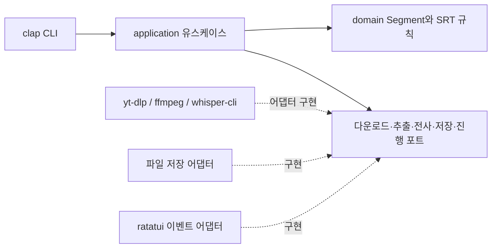

# AutoSRT

YouTube 자동생성 자막을 다운로드하거나 영상·로컬 MP3·MP4 등의 음성을 **로컬에서 인식하여 SRT 자막을 생성하는 Rust CLI**입니다. `ratatui` 진행 화면으로 다운로드, 음성 추출, 전사, 저장 상태를 확인합니다.

```sh
autosrt https://youtu.be/xxx
autosrt example.mp3
```

YouTube 입력은 명령행이나 저장 설정에 모드가 없으면 설치된 `yt-dlp`로 자동자막을 먼저 확인합니다. 자동자막이 없으면 영상을 다운로드하여 `ffmpeg` → `whisper-cli` → Rust SRT 생성 파이프라인을 실행합니다. 로컬 파일은 다운로드 없이 전사하며, `--subtitle-mode`로 YouTube 자막 우선순위를 바꿀 수 있습니다.

## 설치

macOS 15 이상 Apple Silicon에서는 Homebrew로 설치할 수 있습니다.

```sh
brew install yoophi/tap/autosrt
```

다른 환경은 아래 소스 빌드를 사용하세요. 첫 릴리스 바이너리는 macOS ARM64에서 검증했습니다.


Rust stable과 Cargo가 필요합니다. 이 저장소에서 실행합니다.

```sh
cargo install --path . --locked --root ~/.local
```

`~/.local/bin/autosrt`에 릴리스 실행파일이 설치됩니다. `~/.local/bin`이 PATH에 포함되어 있어야 합니다. 현재 구현 및 검증 대상은 macOS/Linux입니다.

### 외부 도구

다음 프로그램을 별도로 설치하고 PATH에 등록하세요.

| 도구 | 용도 | 필수 입력 |
| --- | --- | --- |
| `ffmpeg`, `ffprobe` | 오디오 검사 및 16 kHz mono PCM WAV 변환 | 음성 전사 시. 자막 형식 변환은 ffmpeg 필요 |
| `whisper-cli` | whisper.cpp 기반 로컬 음성 인식 | 음성 전사 시 |
| `yt-dlp` | YouTube 자동자막 조회·다운로드 및 미디어 다운로드 | YouTube URL |
| 지원되는 JavaScript 런타임 및 yt-dlp EJS | YouTube 추출 지원 | YouTube 환경에 따라 필요 |

설치는 각 프로젝트 공식 안내를 따르세요: [yt-dlp](https://github.com/yt-dlp/yt-dlp#installation), [FFmpeg](https://ffmpeg.org/download.html), [whisper.cpp](https://github.com/ggml-org/whisper.cpp#quick-start). yt-dlp의 충분한 YouTube 지원에는 EJS와 지원되는 JavaScript 런타임이 필요하며, 공식 문서는 Deno를 권장합니다. [의존성 안내](https://github.com/yt-dlp/yt-dlp#dependencies)

`whisper.cpp`를 빌드했다면 `build/bin`을 PATH에 추가하세요. 한국어에는 `.en` 전용 모델 대신 다국어 모델을 사용하세요. 모델은 자동 다운로드하지 않습니다.

```sh
# 이미 내려받은 whisper.cpp 모델 경로
autosrt config set model /absolute/path/to/ggml-small.bin
autosrt doctor
```

음성 전사를 시작할 때 모델 검사·미디어 다운로드 전에 전사용 필수 명령을 검사합니다. 누락된 명령이 있으면 목록과 PATH/설치 안내를 stderr에 출력하고 종료 코드 1로 종료합니다. URL의 음성 전사에는 `yt-dlp`, `ffmpeg`, `ffprobe`, `whisper-cli`가 필요하며, 로컬 입력에는 `yt-dlp`가 필요하지 않습니다. 프로그램이 도구를 자동 설치하지 않습니다.

### 의존성 진단

```sh
autosrt doctor                         # YouTube와 로컬 처리 의존성 모두 검사
autosrt doctor --local                 # 로컬 파일용 검사 (yt-dlp·JS·EJS 제외)
autosrt doctor --model /models/ggml-small.bin
```

| 검사 | 확인 내용 |
| --- | --- |
| `ffmpeg`, `ffprobe`, `whisper-cli`, `yt-dlp` | PATH 경로, 실제 버전 명령 실행, 종료 상태 |
| yt-dlp 릴리스 | 버전 날짜가 90일 이상 오래되면 업데이트 경고 |
| YouTube JS·EJS | yt-dlp가 실제 활성화한 런타임과 EJS 진단 정보 |
| 설정 | 파일 경로, JSON 읽기, 기본 언어·자막 모드 유효성 |
| 모델 | 선택된 경로, 읽기 가능 여부, 파일 크기, GGML 헤더 |

결과는 `[OK]`, `[WARN]`, `[FAIL]`로 출력합니다. 실패가 하나라도 있으면 종료 코드 1, 경고만 있거나 모두 정상이면 0을 반환합니다. 한 항목에 실패해도 나머지 검사를 계속해 문제를 한 번에 보여줍니다. 각 외부 명령에는 5초 제한이 있으며 응답이 멈추면 종료하고 실패로 표시합니다.

진단은 네트워크 요청, 모델 전체 로딩, 실제 전사를 수행하지 않습니다. 따라서 YouTube 접근 가능 여부, 모델 전체 무결성, GPU 호환성까지 보장하지는 않습니다. yt-dlp 패키지가 EJS 진단 정보를 제공하지 않으면 확인 불가 경고로 표시합니다. 프로그램 설치나 설정 변경도 수행하지 않습니다.

로컬 파일만 처리할 때는 `yt-dlp`가 없어도 실행할 수 있습니다.

## 사용법

```sh
# 현재 디렉터리에 <video-id>.srt 생성
autosrt https://youtu.be/xxx

# 현재 디렉터리에 example.srt 생성
autosrt example.mp3

# 언어·모델·출력 경로 지정
autosrt example.mp4 --language ko --model /models/ggml-small.bin --output result.srt

# 기존 자막 교체
autosrt example.mp3 --force

# 스크립트·CI용 일반 로그 모드
autosrt example.mp3 --no-tui

# 다운로드 미디어, WAV, 원본 전사 JSON 보존
autosrt example.mp3 --keep-work

autosrt --help
```

`https://youtu.be/xxx`는 사용법을 보여주는 자리표시자입니다. 실제 영상 URL로 바꿔 실행하세요. 출력 디렉터리는 미리 존재해야 합니다. 기존 출력 파일은 `--force` 없이 덮어쓰지 않으며 원본 미디어 파일은 보호합니다.

| 옵션 | 기본값 | 설명 |
| --- | --- | --- |
| `--subtitle-mode <MODE>` | 저장된 `subtitle-mode`, 없으면 `auto-first` | 자동자막·전사 우선순위 또는 모두 생성 |
| `--model <PATH>` | `AUTOSRT_MODEL`, 없으면 저장된 `model` | whisper.cpp 모델 파일 |
| `-l, --language <CODE>` / `--lang <CODE>` | 저장된 `lang`, 없으면 `auto` | 이번 실행의 자동자막 선택·음성 인식 언어. 한국어는 `ko` |
| `-o, --output <PATH>` | 입력 이름 또는 영상 ID + `.srt` | 최종 자막 경로 |
| `--force` | 꺼짐 | 기존 출력 파일 교체 |
| `--no-tui` | 꺼짐 | 비대화형 실행: stdout에 SRT 경로, stderr에 진행/오류 |
| `--keep-work` | 꺼짐 | 임시 작업 파일 보존 |

TUI에서 `q` 또는 `Ctrl+C`를 누르면 실행 중인 작업을 취소합니다. 단계별 진행률과 생성 중인 자막을 포함한 전체 도구 출력을 표시하며, 진행률을 알 수 없으면 작업 중임을 표시합니다.

출력 영역은 6건 제한 없이 실행 중의 전체 기록을 보관합니다. 긴 자막은 화면 폭에 맞춰 줄바꿈합니다. 처음에는 새 출력이 들어올 때마다 맨 아래를 자동으로 따라갑니다. 사용자가 한 번이라도 직접 스크롤하면 새 출력이 들어와도 보고 있던 위치를 유지하며, `End`를 누르면 자동 따라가기를 다시 켭니다.

| 조작 | 동작 |
| --- | --- |
| `↑` / `↓`, `k` / `j` | 한 줄 위·아래로 이동 |
| `Page Up` / `Page Down` | 한 화면 위·아래로 이동 |
| 출력 영역 위의 마우스 휠 | 세 줄씩 이동 |
| `Home` | 처음으로 이동 |
| `End` | 맨 아래로 이동하고 자동 따라가기 재개 |

출력 영역 제목의 `FOLLOW`는 자동 따라가기, `SCROLL`은 수동 탐색 상태입니다. 작업 종료 후에는 기존처럼 터미널로 돌아오며 최종 SRT 경로를 출력합니다. 비대화형 터미널에서는 자동으로 일반 로그 모드를 사용합니다. 성공 시 stdout에는 최종 SRT 경로가 출력됩니다.

기본적으로 임시 미디어·WAV·JSON은 작업 종료 후 정리됩니다. `--keep-work` 사용 시 stderr에 보존 디렉터리가 표시됩니다. 성공은 종료 코드 0, 작업 실패는 1, CLI 인자 오류는 2, 취소는 130입니다.

## 기본 언어 설정

```sh
autosrt config set lang ko   # 기본 인식 언어 저장
autosrt config get lang      # ko
autosrt config list          # 저장된 설정과 기본 언어 표시
autosrt config path          # 설정 파일 경로
autosrt config set model /absolute/path/to/ggml-small.bin
autosrt config get model

autosrt example.mp3                  # 저장된 기본 언어 사용
autosrt example.mp3 --language en    # 이번 실행만 영어 사용
autosrt example.mp3 --lang ja        # 같은 옵션의 별칭
autosrt config set lang auto        # 자동 언어 감지로 변경
```

언어 우선순위는 **명령의 `--language` → 설정 파일의 `lang` → `auto`**입니다. 모델 우선순위는 **`--model` → `AUTOSRT_MODEL` → 설정 파일의 `model`**입니다. `config set model`은 실제 파일인지 확인한 뒤 절대 경로로 저장합니다. 명령별 언어 지정은 저장된 기본값을 바꾸지 않습니다. `ko`, `en`, `ja` 등 Whisper 언어 코드와 `auto`를 지원하며 대문자 입력은 소문자로 저장합니다. 알 수 없는 설정 키와 언어 코드는 오류로 처리합니다.

설정 파일은 `config set` 시 표준 사용자 설정 디렉터리에 생성합니다. macOS 경로는 `~/Library/Application Support/autosrt/config.json`이며, Linux는 `${XDG_CONFIG_HOME:-~/.config}/autosrt/config.json`입니다. 기본 언어가 재부팅 후에도 유지되도록 자동 정리되는 임시·캐시 디렉터리 대신 설정 저장소를 사용합니다. [dirs의 플랫폼별 경로](https://docs.rs/dirs/latest/dirs/fn.config_dir.html)

```json
{
  "lang": "ko"
}
```

`get lang`과 `list`는 파일이 없어도 기본 언어 `auto`를 반환하며 파일을 만들지 않습니다. `get model`은 저장된 모델이 없으면 설정 방법을 안내하며 종료합니다. 설정 명령에는 음성 인식 도구나 모델이 필요하지 않습니다. 파일이 손상되었다면 오류와 경로를 표시하고 기존 내용을 덮어쓰지 않습니다. 별도 설정 디렉터리가 필요한 경우 `AUTOSRT_CONFIG_DIR` 환경변수로 지정할 수 있습니다.

## 구조

Hexagonal Architecture를 사용합니다. `domain`은 자막 데이터와 시간 불변식, `application`은 실행 유스케이스와 포트를 정의합니다. `adapters`가 외부 프로그램, 저장소, 화면을 구현하고 `main`에서 조립합니다.



| 파일 | 책임 |
| --- | --- |
| `src/domain.rs` | Segment, 시간 검증, SRT 직렬화 |
| `src/application.rs` | 포트와 파이프라인 유스케이스 |
| `src/adapters/tools.rs` | 도구 탐지·프로세스 실행·결과 parsing |
| `src/adapters/doctor.rs` | 제한 시간 내 도구 실행, 의존성·설정·모델 진단 |
| `src/adapters/config.rs` | 플랫폼별 설정 경로, 기본 언어 읽기·저장 |
| `src/adapters/storage.rs` | 원자적 저장과 기존 파일 보호 |
| `src/adapters/ui.rs` | TUI·일반 로그·진행 이벤트 |
| `src/main.rs` | 인자와 의존성 조립 |

자세한 결정과 후속 범위는 [설계 문서](docs/design.md), 시각화는 [Archify 설계](.archify/architecture-autosrt-20261029-152000/autosrt.html)를 참고하세요. 다이어그램의 Mermaid 원본은 [source.mmd](.archify/architecture-autosrt-20261029-152000/source.mmd)에 있습니다.

## 개발 및 검증

```sh
cargo fmt --check
cargo clippy --all-targets -- -D warnings
cargo test --locked
```

도메인 테스트는 한국어, 시간 경계, 빈 전사와 잘못된 구간을 검증합니다. CLI 통합 테스트는 가짜 실행파일로 URL·로컬 입력 분기, 인자 전달, 파일 보호, 오류·취소를 검사하며 인터넷이나 모델을 요구하지 않습니다. PTY 기반 테스트로 TUI 취소와 터미널 상태 복구도 검사합니다. 통합 테스트 fixture 실행에는 Python 3가 필요합니다. 실제 음성 인식 품질은 설치한 엔진·모델과 실제 미디어를 사용해 별도로 확인해야 합니다.

## 현재 범위

단일 URL 또는 로컬 파일을 처리합니다. 재생목록, 실시간 방송, 단계별 재개, 화자 분리, 번역, 자막 편집은 아직 지원하지 않습니다. 음성 시작 시각이 미디어 시작 시각과 50 ms 이상 다른 입력은 시간축 오차 방지를 위해 거절합니다. 무음 제거·속도 변경은 하지 않습니다.

Whisper가 GPU 초기화 실패를 명시적으로 보고하면 진행 화면에 알리고 CPU 모드로 한 번 재시도합니다. 다른 엔진 오류나 사용자 취소는 재시도하지 않습니다.

엔진의 segment 시간 경계를 유지하며, 빈 전사나 겹치는·역전된 시간 구간은 오류로 처리합니다. 자막 인식 정확도는 녹음 품질과 모델에 영향을 받습니다. 최초 모델 선택에는 다국어 `small`을 시작점으로 검토하고 사용 환경에서 품질과 속도를 비교하세요.

## 구현 전 설계

다음 기능은 설계 문서만 작성했으며 현재 실행파일에는 구현되지 않았습니다.

- [여러 로컬 파일의 SRT 배치 생성](docs/plans/batch-srt.md): `autosrt *.mp3`, `autosrt a.mp3 b.mp3`
- [다운로드 중 음성 전사](docs/plans/streaming-transcription.md): 오디오 구간이 준비되면 전사 시작

## 기존 ystt 설정 이전

```sh
autosrt config migrate
autosrt config list
autosrt doctor
```

`~/Library/Application Support/ystt/config.json`과 그 디렉터리 내부에 있는 사용 중인 모델을 `~/Library/Application Support/autosrt/`로 복사하고 새 설정의 모델 절대 경로를 갱신합니다. 이전 파일은 보존합니다. 외부에 저장한 모델 경로는 그대로 유지합니다. 새 설정이 이미 있으면 덮어쓰지 않으며, 모델 파일 내용이 충돌하면 오류로 중단합니다. 기존 모델 파일을 읽을 수 없으면 새 설정을 게시하지 않습니다.

이전 전에는 새 설정이 없는 경우 기존 ystt 설정을 읽습니다. `YSTT_CONFIG_DIR`과 `YSTT_MODEL`도 호환 지원하며 `AUTOSRT_*` 환경변수가 우선합니다. `config migrate`는 표준 디렉터리 전용이므로 사용자 지정 설정 디렉터리 환경변수를 해제한 뒤 실행하세요. 기존 `--model` 옵션은 모든 환경변수보다 우선합니다.

## 버전과 릴리스

`YYYY.M.PATCH` CalVer를 사용합니다. 첫 릴리스는 `2026.10.0`입니다. [릴리스 정책과 배포 절차](docs/releases/RELEASING.md)를 참고하세요.

## AI 에이전트와 스크립트에서 사용

`--no-tui`는 입력 앞이나 뒤에 지정할 수 있습니다. 터미널 화면이나 입력 프롬프트 없이 실행합니다.

```sh
autosrt --no-tui 'https://youtu.be/VIDEO_ID' --output ./video.srt
autosrt --no-tui ./example.mp3 --language ko --output ./example.srt
autosrt --help
autosrt doctor --help
```

한 번에 URL 또는 파일 하나를 처리합니다. 성공하면 stdout에는 생성된 UTF-8 SRT 파일 경로를 파일당 한 줄씩 출력하고 (`both`는 최대 두 줄), 진행 로그와 오류는 stderr에 출력합니다. 종료 코드로 성공 여부를 판단하세요: 성공 `0`, 실행 오류 `1`, 인자 오류 `2`, 취소 `130`. 진행 로그는 고정된 기계 판독 형식이 아닙니다.

출력 디렉터리는 미리 만들어야 하며 기존 파일은 `--force`를 지정해야 교체합니다. 의존성·모델을 자동 설치하지 않습니다. `autosrt doctor`로 점검하고 `autosrt config set model /absolute/path/to/ggml-small.bin`으로 모델을 설정하세요. 설정 우선순위, 입력 제한, 재시도 지침은 `autosrt --help`에서 확인할 수 있습니다.

### 같은 자막이 반복되거나 엉뚱한 언어로 인식될 때

먼저 `autosrt config get lang`으로 저장된 인식 언어를 확인하세요. `--language`는 **원본 음성의 언어**이며 번역할 자막 언어가 아닙니다. 영어 음성을 `ko`로 강제하면 잘못된 한국어나 반복 문장이 생성될 수 있습니다.

```sh
autosrt --no-tui 'https://youtu.be/SHGxL8DQOxs' --language en --output ./SHGxL8DQOxs.en.srt
```

한국어 도입부 뒤에 영어 본문이 있는 영상에서는 `auto`도 처음의 한국어를 선택할 수 있습니다. 현재 엔진은 한 파일 안의 언어 전환을 자동 처리하지 않습니다. 본문 언어를 명시하거나, 각 언어 구간을 나누어 별도로 인식해야 합니다. 영어를 지정하면 한국어 도입부의 정확성은 보장되지 않습니다. 반복 문장을 삭제하는 것만으로 누락된 음성이 복구되지는 않습니다.

`GPU initialization failed; retrying on CPU`는 CPU 전환 안내입니다. GPU 초기화 문제와 언어 불일치는 별도로 진단해야 하며, CPU에서 실행된다고 인식 결과가 올바른 것은 아닙니다. `doctor`는 실제 GPU 실행이나 전사 품질까지 검사하지 않습니다.

### Whisper가 SIGPIPE로 종료될 때

일부 Whisper 출력에는 불완전한 UTF-8 토큰이 포함될 수 있습니다. AutoSRT는 로그를 바이트 단위로 읽고 표시할 때 손상된 바이트를 `�`로 대체하여 출력 파이프가 조기에 닫히지 않도록 합니다. 전사 JSON의 문자열에도 손상된 바이트가 있으면 `�`로 대체하고 TUI 또는 stderr에 경고를 표시합니다. 생성된 SRT에서 `�`가 있는 자막은 원음과 비교해 교정하세요. JSON 구조 오류는 자동 복구하지 않고 실패로 처리합니다. 이 처리는 GPU 초기화 실패 후 CPU 재시도와 별개입니다.

## YouTube 자동생성 자막과 음성 전사 우선순위

YouTube 입력은 **명령행·저장 설정에 모드가 없을 때 자동자막을 먼저 확인**합니다. 요청한 언어의 자동자막이 있으면 영상·음성을 다운로드하거나 Whisper를 실행하지 않고 SRT를 저장합니다. 없거나 다운로드에 실패하면 경고를 표시하고 음성을 전사합니다. 기존 방식만 사용하려면 `transcribe-only`를 지정하세요.

```sh
# 한국어 자동자막 우선, 없으면 한국어 음성 전사
autosrt --no-tui 'https://youtu.be/HYkXmBCHtTE' --language ko

# 음성 전사 우선, 실패하면 자동자막 시도
autosrt URL --subtitle-mode transcribe-first

# 두 종류를 각각 저장: result.auto.srt, result.transcribed.srt
autosrt URL --language ko --subtitle-mode both --output result.srt

# 자동자막만 다운로드 (없으면 오류, 음성 전사하지 않음)
autosrt URL --language ko --subtitle-mode auto-only

# 항상 음성 전사
autosrt URL --subtitle-mode transcribe-only

# 기본값 저장 / 조회
autosrt config set subtitle-mode auto-first
autosrt config get subtitle-mode
autosrt config list
```

| 모드 | 처리 순서와 결과 |
| --- | --- |
| `auto-first` (기본) | 자동자막 → 없거나 실패하면 전사. SRT 하나 |
| `transcribe-first` | 전사 → 처리 실패하면 자동자막. SRT 하나 |
| `both` | 자동자막 확인·다운로드 후 전사. `.auto.srt`, `.transcribed.srt`로 분리 |
| `auto-only` | 자동자막만 사용. 없거나 실패하면 종료 코드 1 |
| `transcribe-only` | 자동자막 조회 없이 전사 |

옵션 우선순위는 **`--subtitle-mode` → 설정 파일의 `subtitle_mode` → `auto-first`**입니다. 언어는 기존 `--language`/`lang` 설정을 함께 사용합니다. 지정 언어의 `ko-orig` 같은 원본 트랙이 있으면 우선 선택하고 없으면 `ko` 트랙을 사용합니다. `auto`는 영상 메타데이터의 원본 언어나 `-orig` 트랙을 선택합니다. 원본 언어를 알아낼 수 없으면 임의의 번역 언어를 고르지 않고 자동자막 없음으로 처리합니다. YouTube에서 제공하는 번역 자동자막이 명시한 언어로 선택될 수 있지만, Whisper 자체는 번역하지 않습니다. 수동 작성 자막은 대상이 아닙니다.

자동자막의 타임스탬프와 텍스트는 유지합니다. YouTube의 겹치는 구간이나 반복 표시도 임의로 제거하지 않습니다. SRT가 제공되지 않으면 yt-dlp와 FFmpeg로 다른 자막 형식을 SRT로 변환합니다. [yt-dlp 자막 옵션](https://github.com/yt-dlp/yt-dlp#subtitle-options)

로컬 파일은 `auto-only`를 제외한 모든 모드에서 전사만 수행하며 일반 `.srt` 하나를 생성합니다. `auto-only`에 로컬 파일을 지정하면 오류입니다. 자동자막 다운로드 성공 시 Whisper·모델은 필요하지 않고, SRT로 제공되는 자막은 FFmpeg도 필요하지 않습니다. `doctor`는 여전히 전체 전사 도구와 모델을 검사합니다.

`both`에서 자동자막이 없으면 경고 후 `.transcribed.srt`만 생성합니다. 자동자막 다운로드 또는 전사가 실패하면 오류로 종료하며, 처리 실패 전에 결과 파일을 저장하지 않습니다. 기존 파일은 `--force` 없이는 덮어쓰지 않습니다. 두 파일은 각각 원자적으로 저장하지만 두 파일 전체가 하나의 트랜잭션은 아니므로 저장 도중 파일 시스템 오류나 취소가 발생하면 첫 파일만 남을 수 있습니다. 취소나 출력 파일 충돌은 다른 자막 소스로의 재시도를 유발하지 않습니다.

### 언어와 대체 처리의 경계

`--language`와 `config set lang`은 자동자막 트랙 선택과 원음 전사에 같은 언어 값을 사용합니다. 두 명령은 동일한 고정 언어 코드 목록만 허용하며, 전체 목록은 `autosrt --help`의 언어 옵션과 `autosrt config set --help`에 표시합니다. 임의의 YouTube 트랙 ID(`ko-orig`), 정규식, 지역 태그(`ko-KR`)는 직접 입력할 수 없습니다.

`auto`는 자동자막에서 원본 트랙을 선택하고, 음성 전사에서는 초기 음성의 언어를 감지합니다. `both`에 한국어를 지정하면 두 소스 모두 한국어를 사용하므로, 한국어 번역 자동자막과 영어 원음 전사를 동시에 요청하는 설정이 아닙니다. 이 경우 출력 경로를 달리한 두 명령을 사용하세요.

```sh
autosrt URL --subtitle-mode auto-only --language ko --output translated-ko.srt
autosrt URL --subtitle-mode transcribe-only --language en --output spoken-en.srt
```

`transcribe-first`는 전사 도구 누락, 모델 미설정·파일 부재, 미디어 다운로드·음성 추출·전사 실패에도 자동자막을 시도합니다. 인자 해석·입력 검증·설정 로딩 오류와 취소·출력 충돌·저장 오류는 대체 처리를 하지 않습니다. 자동자막에도 yt-dlp가 필요하고 형식 변환에는 ffmpeg가 필요하므로, 같은 의존성 부재로 대체 처리 역시 실패할 수 있습니다.

`both`의 출력 소스는 stdout 경로 개수만으로 추정하지 말고 `.auto.srt` / `.transcribed.srt` 접미사로 구분하세요. `doctor`는 모델·Whisper까지 검사하므로 자동자막만 다운로드할 수 있는 환경에서도 실패할 수 있으며, 현재 자동자막 전용 진단 옵션은 없습니다.
