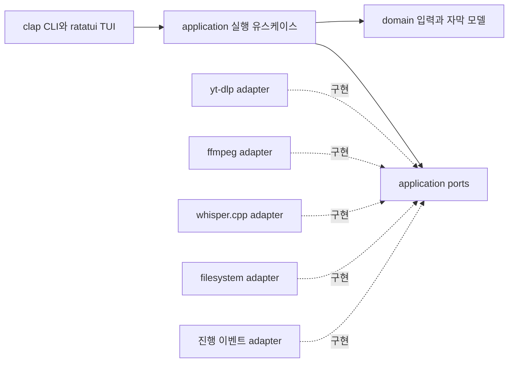
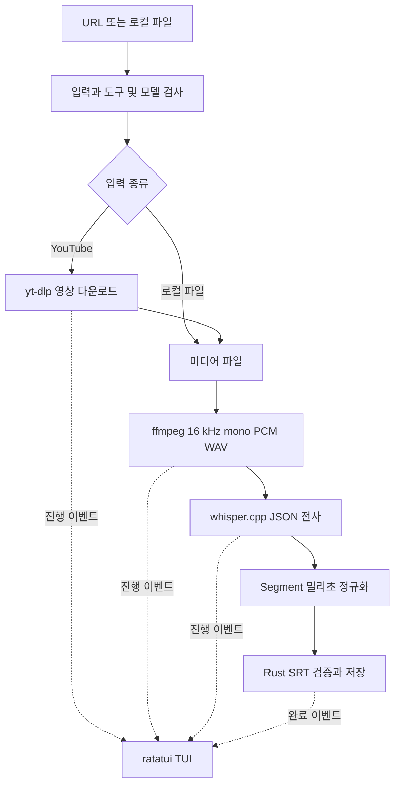
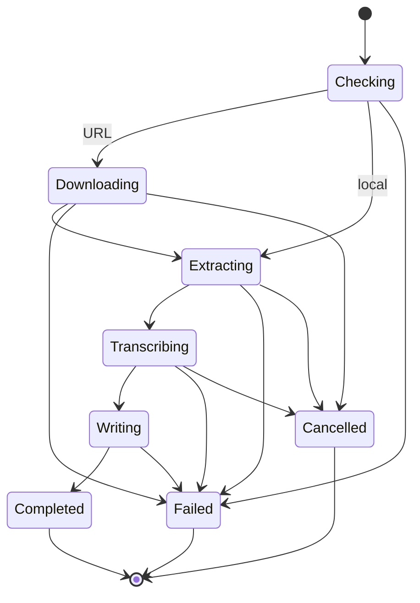

# autosrt 설계

Rust CLI `autosrt <YouTube URL | 로컬 미디어 파일>`은 설치된 도구로 미디어를 준비하고 로컬 음성 인식을 실행하여 UTF-8 SRT를 생성한다. 진행 상황은 ratatui TUI에 표시한다. 코드는 Hexagonal Architecture로 구성하여 도메인과 유스케이스를 외부 도구·UI에서 분리한다.

## 사용 계약

```sh
autosrt https://youtu.be/xxx
autosrt example.mp3
autosrt example.mp4 --language ko --model /models/ggml-small.bin
autosrt example.mp3 --output subtitles.srt --no-tui
autosrt doctor
```

URL은 영상과 음성을 내려받고, 로컬 입력은 다운로드를 건너뛴다. 기본 출력은 현재 디렉터리의 `<video-id>.srt` 또는 `<입력파일명>.srt`다. 기존 출력은 기본적으로 보호하며 `--force`로 교체한다. 원본 로컬 파일은 수정하지 않는다. 모델은 `--model`, `AUTOSRT_MODEL`, 설정 파일의 `model` 순으로 선택하고 없으면 설정 안내와 함께 종료한다. 모델·도구 자동 다운로드는 초기 범위에서 제외한다.

## 구성과 의존성

Rust의 domain은 표준 라이브러리만 사용하고 application은 domain 및 자신이 정의한 포트만 참조한다. adapters가 포트를 구현하며 main이 모든 구체 타입을 조립한다. CLI/TUI는 driving adapter, yt-dlp·ffmpeg·whisper.cpp·파일 저장은 driven adapter다.



| 경로 | 책임 |
| --- | --- |
| `src/domain.rs` | 입력 종류, Segment, Transcript, 시간·SRT 불변식 |
| `src/application.rs` | 다운로드 → 정규화 → 인식 → 출력 유스케이스, 포트 정의 |
| `src/adapters/tools.rs` | 외부 프로그램 탐지·실행·결과 해석 |
| `src/adapters/storage.rs` | 작업 디렉터리와 출력 파일 저장 |
| `src/adapters/ui.rs` | 이벤트를 TUI 또는 일반 터미널 로그로 렌더링 |
| `src/main.rs` | clap 인자, 의존성 조립, 종료 코드 |

초기 구현은 단일 crate 안에서 모듈 경계를 유지한다. 다운로드·변환·인식·출력 포트를 mock으로 대체할 수 있어 테스트에 인터넷이나 모델이 필요하지 않다. FFI와 엔진 내장 대신 whisper-cli 프로세스를 사용해 Rust 빌드와 엔진 설치를 분리한다.

## 데이터 파이프라인



여기서 파이프라인은 단계별 파일을 전달하는 방식이다. 큰 영상 전체를 Rust 메모리에 적재하지 않으며, 다운로드의 stdout을 영상 바이너리로 다음 프로세스에 직결하지 않는다. 이렇게 하면 다운로드 결과의 실제 경로와 오류를 확인할 수 있고 각 엔진의 파일 입력 요구사항을 만족한다. stdin 스트리밍 지원은 후속 확장이다.

## 외부 도구 계약

### yt-dlp

PATH에서 `yt-dlp`를 찾고 URL 입력에서만 필수로 검사한다. 호출은 `Command::args`로 구성하여 셸 해석을 거치지 않는다. 사용자 설정이 파이프라인 계약을 바꾸지 않게 `--ignore-config`를 사용한다.

```sh
yt-dlp --ignore-config --no-playlist --newline --no-simulate \
  --progress --progress-template 'download:AUTOSRT_PROGRESS %(progress._percent_str)s' \
  -f 'bv*+ba/b' --merge-output-format mkv \
  -o '<workdir>/%(id)s.%(ext)s' \
  --print 'after_move:AUTOSRT_FILE %(filepath)s' -- '<url>'
```

고정 마커로 진행·최종 경로를 구분한다. 파일명이나 확장자를 추정하지 않고 병합 후 경로를 사용한다. YouTube URL만 허용하고 플레이리스트·라이브 스트림은 초기 범위에서 제외한다. 접근 제한은 해당 오류로 보고하며 반복 재시도로 숨기지 않는다. 현재 yt-dlp는 충분한 YouTube 지원에 EJS 및 지원되는 JavaScript 런타임이 필요하므로 doctor에 안내한다. [yt-dlp 공식 문서](https://github.com/yt-dlp/yt-dlp)

### ffmpeg

ffprobe로 길이와 오디오 유무를 확인하고 첫 오디오 트랙을 선택한다. 영상의 처음부터 추출하여 시간축을 유지한다. 초기 버전은 오디오 시작 시각이 영상 기준 0과 다른 입력을 검사하고 명시적으로 처리하거나 거절해야 한다. 무음을 제거하거나 재생 속도를 변경하지 않는다.

```sh
ffmpeg -nostdin -hide_banner -y -i '<media>' -map 0:a:0 \
  -vn -ac 1 -ar 16000 -c:a pcm_s16le \
  -progress pipe:1 -nostats '<workdir>/audio.wav'
```

`out_time_us`를 밀리초로 변환해 전체 길이로 나눈다. 길이를 모르면 spinner를 표시한다. WAV는 약 115 MB/시간이므로 충분한 임시 디스크 공간이 필요하다. 외부 도구 출력은 지속적으로 읽어 pipe 버퍼 교착을 방지한다.

### whisper.cpp

기본 엔진은 `whisper-cli`다. Apple Silicon에서 Metal을 지원하며 CPU 실행도 가능하다. 모델은 다국어 `small`을 시작점으로 제안하되 사용자가 설치한 모델을 명시적으로 선택한다. 실제 속도·정확도는 입력과 장비에서 측정한다. [whisper.cpp 공식 문서](https://github.com/ggml-org/whisper.cpp)

```sh
whisper-cli -m '<model.bin>' -f '<workdir>/audio.wav' \
  -l auto -oj -of '<workdir>/transcript' -pp
```

`transcription[].offsets.from/to`는 밀리초로 읽고 text와 함께 공통 Segment로 변환한다. 엔진의 진행 출력 형식을 인식하지 못하면 spinner로 표시한다. 완료 JSON 검증 전에는 성공으로 판정하지 않는다. SRT 출력은 Rust가 담당해 엔진 교체 시에도 동일한 형식을 유지한다. [whisper-cli 소스](https://raw.githubusercontent.com/ggml-org/whisper.cpp/master/examples/cli/cli.cpp)

## TUI

ratatui와 crossterm으로 전체 화면을 구성한다. 입력·현재 단계·진행률·경과 시간·전체 출력 기록을 표시하고, 완료 후 출력 위치를 출력한다. 단계는 검사, 다운로드, 음성 추출, 전사, 자막 저장이며 로컬 입력에서는 다운로드를 생략한다. 작업 스레드와 UI 스레드는 이벤트 채널로 연결하고 UI는 일정 주기로 다시 그린다. 단계별 진행률만 표시하며 근거 없는 종합 백분율이나 남은 시간을 만들지 않는다. [Ratatui 애플리케이션 패턴](https://ratatui.rs/concepts/application-patterns/)

- `q` 또는 `Ctrl+C`: 실행 중인 프로세스 취소, 종료 대기, 터미널 복구.
- resize: 현재 크기에 맞춰 다시 배치.
- `--no-tui` 또는 비대화형 터미널: stderr에 단계·진행 로그, stdout에는 최종 SRT 경로만 출력.
- 성공·오류·panic 경로에서 raw mode와 alternate screen을 복구한다.

## 자막 규칙

시간은 음수 없는 정수 밀리초이며 `start < end`를 만족한다. cue 번호는 1부터 연속이고 시간은 `HH:MM:SS,mmm` 형식이다. 빈 텍스트는 제외한다. 역순·겹치는 구간은 임의로 숨기지 않고 검증 오류로 보고한다. UTF-8 텍스트의 줄바꿈은 보존하되 cue 구분을 깨는 연속 공백 줄을 정리한다. 초기에는 엔진의 segment 경계를 유지하며 단어별 시각 없이 글자 수에 비례해 시간을 재분배하지 않는다. 전사가 비어 있으면 빈 파일을 성공으로 만들지 않고 `NoSpeech`로 보고한다.

## 오류와 수명주기



초기 구현은 단일 작업을 실행한다. 작업별 임시 디렉터리로 충돌을 방지하고 최종 파일은 같은 디렉터리에 임시 파일을 쓴 뒤 원자적으로 게시한다. 기존 파일 보호는 검사와 생성 사이 경쟁도 방지한다. `--keep-work`를 주면 중간 미디어·WAV·JSON을 보존한다. 기본적으로 완료·실패·취소 시 임시 파일을 정리한다. 종료 코드는 성공 0, CLI 인자 오류 2, 작업 실패 1, 취소 130이다.

재개는 후속 단계로 분리한다. 작업 manifest에 입력 fingerprint, 모델 hash, 도구 버전, 옵션 hash, 단계 산출물 checksum을 저장한 뒤 `--resume <job>`에서 일치하는 단계만 재사용한다. 모델 변경은 전사부터, 자막 옵션 변경은 자막 생성부터 무효화한다. 초기 버전에 재개가 구현된 것처럼 표시하지 않는다.

## 구현 순서와 수락 기준

1. domain 및 ports: 입력 분류, 공통 전사 모델, SRT 직렬화·오류 검증.
2. 외부 도구 및 application: 로컬 MP3와 URL 분기, 설치 탐지, JSON parsing, 파일 게시.
3. CLI 및 TUI: `autosrt <input>`, 옵션, 진행 이벤트, 취소와 터미널 복구.
4. 검증 및 문서: fmt/clippy/test, 가짜 실행파일로 외부 도구 계약 통합 테스트, 사용법과 설치 안내.

테스트에는 한국어, 1시간 이상 타임스탬프, 빈 음성, 시간 역전, 기존 출력 충돌, 도구 누락, 로컬 입력 다운로드 생략, 외부 프로그램 실패, 취소를 포함한다. 실제 모델과 미디어가 준비되어 있을 때 실제 전사 smoke test를 추가한다. 네트워크·모델이 없는 통합 테스트는 프로세스 계약 검증이며 음성 인식 정확도를 검증한 것으로 간주하지 않는다.

## 후속 확장

단계별 재개, 재생목록 배치, 단어 타임스탬프 기반 줄 나누기, VAD, 화자 분리, 번역, whisper-rs FFI 및 다른 엔진 어댑터. UI와 도메인의 의존 방향은 유지한다.

## 기본 언어 설정

`autosrt config set lang ko`, `autosrt config get lang`, `autosrt config list`로 기본 언어를 관리한다. `config path`는 설정 파일 위치를 출력한다. macOS에서는 `~/Library/Application Support/autosrt/config.json`을 사용하며 `config set`이 디렉터리와 파일을 생성한다. Linux에서는 표준 XDG 설정 디렉터리를 사용한다. 테스트 및 별도 프로필에는 `AUTOSRT_CONFIG_DIR`을 제공한다.

CLI driving adapter가 명령 언어 > 파일의 lang > auto 순으로 값을 결정하고 Whisper 어댑터에 주입한다. 설정 파일 I/O는 `adapters/config.rs`에 두고 application/domain에는 경로·JSON 의존성을 추가하지 않는다. 설정은 원자적으로 교체하며, 잘못된 JSON과 언어 코드 오류를 명시적으로 보고한다. get/list는 유효 기본값을 출력하며 파일을 생성하지 않는다.

## 필수 명령 사전 검사와 기본 모델

입력 분류 직후 URL은 yt-dlp/ffmpeg/ffprobe/whisper-cli, 로컬 파일은 ffmpeg/ffprobe/whisper-cli의 PATH 실행파일을 검사한다. 누락 목록을 한 번에 stderr로 출력하고 종료 코드 1로 종료하며, 모델 검사와 작업 실행은 시작하지 않는다. 프로그램은 외부 도구를 자동 설치하지 않는다.

`autosrt config set model <path>`로 실제 파일의 절대 경로를 저장한다. `config get model` 및 `config list`로 조회한다. doctor와 전사 명령 모두 저장된 모델을 사용한다. CLI의 --model과 AUTOSRT_MODEL이 저장된 모델보다 우선한다.

## doctor 진단 명령

정식 하위 명령 `autosrt doctor`는 도구 버전 명령을 실제 실행하여 PATH에만 존재하는 깨진 shim까지 진단한다. `--local`은 YouTube 도구 검사를 생략한다. 도구별 5초 타임아웃과 파일 기반 출력 캡처로 무한 대기·pipe 교착을 방지한다. yt-dlp의 URL 없는 verbose 진단에서 실제 JS 런타임과 EJS 정보를 읽으며 프록시 등 전체 debug 출력은 노출하지 않는다.

설정과 선택된 모델의 읽기 가능 여부 및 GGML 헤더를 검사하고, OK/WARN/FAIL을 모아 표시한다. FAIL이 있으면 종료 코드 1, 없으면 0이다. 90일을 넘긴 yt-dlp 버전에는 업데이트 경고를 표시한다. 네트워크·전체 모델 로딩·GPU 연산은 수행하지 않으며 실제 다운로드나 전사 성공 여부는 별도로 검증한다.

## 출력 기록과 스크롤

TUI는 실행 중 수신한 전체 출력 행을 보관한다. 로그 이벤트는 bounded channel에서 유실 없이 전달하고, 진행률 이벤트만 필요 시 생략한다. UI는 한 프레임당 최대 512개 이벤트를 처리해 키 입력이 밀리지 않도록 한다. 전체 기록 중 화면에 보이는 행만 렌더링하므로 65,535행을 넘어도 탐색할 수 있다.

사용자 스크롤 전에는 마지막 행을 따라가며, 위·아래/Page/Home/휠 조작 시 수동 모드로 전환한다. 수동 모드에서는 새 출력으로 위치를 변경하지 않으며 End로 따라가기를 명시적으로 재개한다. 화면 크기 변경 시 한국어·유니코드 grapheme 폭을 고려하여 재배치한다. 작업 종료 시 마우스 캡처와 터미널 모드를 복구한다.
