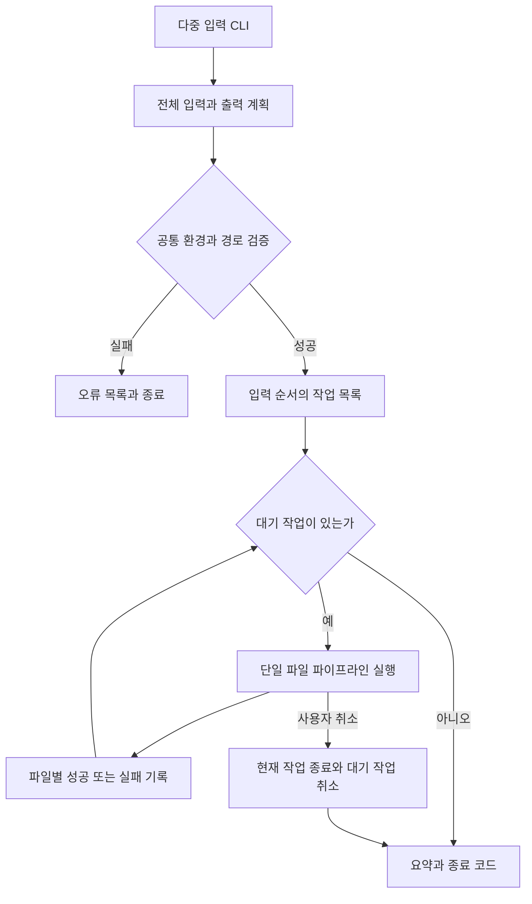

# 여러 로컬 파일의 SRT 배치 생성 설계

상태: 설계 제안. 구현하지 않음.

`autosrt *.mp3`와 `autosrt a.mp3 b.mp3`로 여러 입력을 받아 파일마다 독립적인 SRT를 생성한다. 첫 버전은 입력 순서대로 하나씩 처리한다. 현재 단일 파일 파이프라인과 기본 언어·모델 설정을 재사용하고, 파일별 실패를 분리한다. 다운로드 중 전사 기능과 독립적으로 도입할 수 있다.

## 사용 계약

아래 명령과 옵션은 구현 예정인 제안이다.

```sh
autosrt *.mp3
autosrt a.mp3 b.mp3
autosrt "회의 1.mp3" "회의 2.mp3" --language ko
autosrt a.mp3 b.mp3 --output-dir ./subtitles
autosrt a.mp3 b.mp3 --force
autosrt a.mp3 b.mp3 --no-tui --report ./batch-result.json
```

macOS zsh/bash에서는 셸이 `*.mp3`를 파일 목록으로 확장한다. autosrt는 확장된 인자를 그대로 받으며 자체 glob 확장을 추가하지 않는다. `autosrt '*.mp3'`처럼 따옴표로 감싸면 리터럴 경로로 해석하고 해당 파일이 없으면 오류를 표시한다. 매칭 파일이 없는 경우 zsh는 autosrt 실행 전에 오류를 낼 수 있다.

인자 순서를 보존한다. 와일드카드의 확장 순서는 셸이 결정한다. 파일명에 공백이 있으면 명시적으로 인용하고, `-`로 시작하는 이름은 `autosrt -- -recording.mp3`처럼 전달한다. `doctor`, `config`라는 로컬 파일은 `./doctor`, `./config`로 지정한다.

- 입력 1개: 기존 URL·로컬 파일 동작과 `--output`을 유지한다.
- 입력 2개 이상: 첫 버전은 로컬 미디어만 허용한다. URL 목록이나 URL·로컬 혼합은 전체 사전 검증에서 거절한다.
- 언어·모델·`--force`·`--keep-work`·`--no-tui`는 배치 전체에 적용한다. 파일별 옵션은 이번 범위에 포함하지 않는다.
- `--output`은 입력 1개일 때만 허용한다. 여러 입력에는 `--output-dir`을 사용한다. 두 옵션의 동시 사용은 거절한다.
- `--output-dir` 기본값은 현재 디렉터리다. 지정 디렉터리가 없으면 실행 전에 오류를 표시한다.

## 출력 이름과 충돌

| 입력 | 기본 출력 |
| --- | --- |
| `a.mp3` | `./a.srt` |
| `b.mp3` | `./b.srt` |
| `meeting.part1.mp3` | `./meeting.part1.srt` |
| `folder/a.mp3` | `./a.srt` |

오디오·비디오 확장자를 제거한 stem을 사용하고 나머지 이름은 보존한다. 배치 시작 전 모든 출력 경로를 계산하여 충돌을 검사한다.

- `a.mp3`와 `a.wav`, `folder1/a.mp3`와 `folder2/a.mp3`처럼 출력이 겹치면 전체 실행을 거절하고 충돌 입력 쌍을 표시한다. `--force`도 배치 내부 충돌을 허용하지 않는다.
- 같은 입력의 중복 지정도 명시적 입력 오류로 처리한다. canonical path 및 가능한 경우 파일 식별자로 심볼릭 링크·하드 링크 별칭을 식별한다.
- macOS의 대소문자 비구분 파일시스템을 고려해 출력 파일명 비교에 Unicode 정규화와 case-fold를 보수적으로 적용한다. 대소문자 구분 디렉터리에서도 잠재 충돌을 거절할 수 있음을 문서화한다.
- 기존 SRT가 있으면 `--force` 없이는 전체 사전 검증을 실패시킨다. 실행 중 다른 프로세스가 생성한 파일과의 경쟁은 기존 원자적 no-clobber 저장으로 방지한다.
- 어떤 출력 경로도 배치의 다른 입력 파일을 덮어쓰면 안 된다. 심볼릭 링크, 하드 링크, 디렉터리 별칭을 포함해 검증한다.

전체 배치를 시작하기 전에 잘못된 경로·중복·출력 충돌을 발견하여 일부 파일만 뜻하지 않게 처리되는 일을 줄인다. 디스크 부족이나 읽기 오류 등 실행 도중 발생하는 문제는 파일별 실패로 기록한다.

## 실행 흐름과 오류



공통 의존성·모델·설정 오류는 배치 전체를 즉시 중단한다. 모든 파일에 같은 실패를 반복하지 않는다. 미디어에 오디오가 없거나 디코딩·전사·출력 저장이 실패하면 해당 파일만 실패 처리하고 다음 입력으로 진행한다. 기본 정책은 실패 후 계속 처리다. 첫 버전에 별도의 fail-fast 옵션은 도입하지 않는다.

각 파일마다 독립 임시 디렉터리를 사용한다. 완료된 SRT는 즉시 원자적으로 게시하며 이후 파일 실패나 취소가 앞선 성공 결과를 삭제하지 않는다. `--keep-work` 사용 시 파일별 작업 디렉터리를 결과에 기록한다.

`q` 또는 `Ctrl+C`는 배치 전체 취소를 뜻한다. 현재 자식 프로세스와 프로세스 그룹 종료를 기다린 후 현재·대기 작업을 Cancelled로 기록한다. 취소 시 새 작업을 시작하지 않는다. 파일 게시가 이미 완료되었다면 그 작업은 Succeeded로 유지한다.

| 종료 코드 | 의미 |
| --- | --- |
| `0` | 모든 입력 성공 |
| `1` | 의존성/모델 실패 또는 한 파일 이상 처리 실패 |
| `2` | 잘못된 인자·입력 목록·출력 경로 충돌 |
| `130` | 사용자 취소. 이전 성공 SRT는 유지 |

`--no-tui`에서는 진행·최종 집계를 stderr, 성공한 SRT 경로를 입력 순서대로 stdout에 출력한다. 선택적 `--report`는 입력, 출력, 상태, 소요 시간, 오류 코드·설명, 보존 작업 디렉터리를 JSON으로 저장한다. 정상 종료·취소 시 결과 보고서를 원자적으로 게시하며 보고서 저장 실패도 stderr로 알리고 성공 코드 0을 반환하지 않는다. 취소와 보고서 오류가 함께 있으면 종료 코드 130을 유지한다.

## TUI와 스크롤

상단에는 `완료 3 / 전체 10`, 성공·실패·대기 개수와 경과 시간을 표시한다. 전체 진행률은 완료 작업 수 기준이며 각 작업의 시간을 동일하게 추정하지 않는다. 선택한 작업의 기존 단계별 진행률도 별도로 표시한다.

작업 목록과 선택한 작업의 전체 출력 영역으로 나눈다. `Tab`으로 포커스를 전환한다. 작업 목록에서는 방향키로 파일을 선택하고, 출력 영역에서는 기존 방향키/Page/Home/End/휠 동작을 유지한다. 출력 기록과 스크롤 위치·자동 따라가기 상태는 작업별로 독립적이다.

사용자가 작업을 선택하기 전에는 현재 실행 중인 작업을 보여준다. 직접 선택한 뒤에는 다음 작업이 시작되어도 선택을 바꾸지 않는다. 명시적인 `f` 키로 현재 작업 따라가기를 재개한다. 출력 영역의 `End`는 선택한 작업의 자막 따라가기에만 영향을 준다.

실행 종료 후에는 기존 CLI처럼 TUI를 닫고 파일별 실패와 최종 집계를 표시한다. 완료 화면에 머무르는 기능은 별도 확장이다. 출력 기록은 현재 스크롤 구현처럼 메모리에 유지한다. 매우 큰 배치의 로그 디스크 저장은 후속 설계 과제이며 첫 버전에서 자동 병렬화를 하지 않는다.

## Hexagonal Architecture 변경 지점

| 계층 | 제안 |
| --- | --- |
| domain | `JobId`, `JobSpec`, `JobStatus`, `JobResult`, `BatchSummary` |
| application | `BatchPlanner`가 전체 사전 검증, `BatchRunner`가 순차 실행·실패 격리·취소 관리 |
| application ports | 입력 식별/출력 검사 포트, 결과 보고서 저장 포트, JobId가 포함된 진행 이벤트 |
| existing pipeline | 계획된 입력·출력 한 쌍을 처리하는 단일 작업 유스케이스로 재사용 |
| CLI adapter | positional input을 목록으로 파싱, `--output-dir`와 `--report` 검증 |
| filesystem adapter | 경로 별칭·충돌 검사, 원자적 파일/보고서 저장 |
| TUI adapter | 작업 목록, 선택 상태, 작업별 출력 기록·스크롤 |

도메인과 유스케이스는 clap·ratatui·파일시스템 구체 API에 의존하지 않는다. 현재 `Request`의 출력 계산을 사전 계획 단계와 공유해 CLI와 실제 저장 경로가 달라지지 않도록 한다.

## 구현 계획과 수락 기준

현재 문서는 계획만이며 아래 작업은 실행하지 않는다.

1. 다중 입력 파싱과 출력 계획: 두 명시 파일·와일드카드 확장 목록·공백 파일명·중복·충돌·잘못된 옵션을 검증한다.
2. 순차 배치 유스케이스: 성공/실패/성공 입력에서 세 번째 파일까지 처리하고 종료 코드 1을 반환한다.
3. 파일별 결과와 취소: 중간 취소 시 첫 성공 파일 유지, 현재 작업 종료, 나머지 작업 미시작을 확인한다.
4. TUI 작업 목록: 선택한 작업의 스크롤이 새 출력과 다른 작업의 진행에 영향을 받지 않는지 검증한다.
5. 보고서와 회귀: 전체 집계·상태·stdout 순서, JSON 보고서 저장 실패, 단일 URL/파일·config·doctor의 기존 동작을 검증한다.

첫 버전은 순차 처리로 한 개의 Whisper 프로세스만 실행한다. `--jobs N` 동시 전사는 모델별 메모리와 CPU/GPU 자원 제한을 측정한 뒤 별도 확장으로 검토한다.
