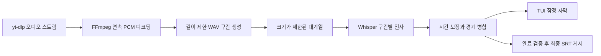

# 다운로드 중 음성 전사를 시작하는 설계

상태: 설계 제안. 구현하지 않음.

현재 autosrt는 영상 다운로드·병합이 완료된 파일에서 음성을 추출한다. 다운로드 완료 전에 자막을 만들려면, 내려오는 오디오를 연속 디코딩하고 준비된 구간부터 전사하는 별도 경로가 필요하다. 목표는 첫 자막이 보일 때까지의 시간을 줄이는 것이며 전체 처리 속도 개선을 보장하지 않는다.

## 제안하는 처리 방식

초기 도입은 명시적 `--stream` 옵션으로 제한한다. 기존 전체 파일 처리 방식은 기본으로 유지한다. 우선 오디오 전용 다운로드를 대상으로 하며, 원본 영상까지 보존하는 동작은 별도 결정 전까지 제공하지 않는다. 현재 영상 다운로드 모드와 결과물 차이를 CLI 도움말에 명시한다.

미완성 영상 `.part` 파일을 반복해서 열지 않는다. 지원되는 다운로드 형식에서 오디오 바이트를 전달하고 FFmpeg가 한 번의 연속 디코딩으로 PCM을 생성하도록 한다. 이 방식은 압축 패킷 경계와 임의 파일 구간을 혼동하지 않는다. 실제 yt-dlp 포맷·진행 로그 채널·FFmpeg stdin 동작은 구현 전 짧은 프로토타입으로 검증한다.

첫 기준값은 30초 구간과 2초 중첩으로 제안한다. 수치는 측정으로 조정한다. 모델을 매 구간 다시 로딩하는 whisper-cli 방식은 지연이 클 수 있으므로 먼저 측정하고, 필요할 때 지속 실행 엔진 포트를 검토한다. 초기 설계에서 FFI 도입을 전제하지 않는다.

## 시간축과 경계

PCM 샘플 수를 기준으로 구간 시작 시각을 관리한다. 16 kHz 오디오에서 `global_ms = chunk_start_sample × 1000 / 16000 + local_ms`로 전역 시각을 계산하고, 반올림 오차를 누적하지 않는다. 다운로드 시각이나 네트워크 도착 시각으로 자막 시각을 만들지 않는다.

중첩 구간의 시간과 정규화된 텍스트를 함께 비교하여 중복 후보를 찾는다. 같은 문장이 실제로 반복된 경우를 제거하지 않도록 시간 일치가 필수다. 단어 단위 시각이 없는 엔진에서 문장 일부를 임의로 잘라내면 안 된다. 애매한 경계는 두 구간을 합쳐 재전사하거나 경계 구간 확정을 늦춘다. 마지막 구간을 제외한 꼬리 구간은 다음 전사와 비교하기 전까지 잠정 상태다.

TUI에서는 잠정 자막과 확정 자막을 구분한다. 다운로드·디코딩·모든 구간 전사와 최종 SRT 검증까지 성공해야 기존 출력 위치에 `.srt`를 게시한다. 실패·취소 시 부분 결과는 최종 자막으로 취급하지 않는다. `--keep-work`가 켜져 있으면 중간 JSON과 작업 manifest를 보존하며, 부분 SRT 공개는 후속 옵션으로 남긴다.

## 자원과 오류

- 대기열은 메모리 대신 작업 디렉터리의 구간 파일을 참조하며 최대 대기 PCM 길이를 제한한다. 한도를 넘으면 소비 속도에 맞춰 역압을 전달한다.
- 역압 때문에 네트워크가 장시간 멈추는 포맷은 디스크 spool과 용량 상한을 별도 설계한다. 제한을 넘으면 명확하게 실패하고 무제한 다운로드를 계속하지 않는다.
- yt-dlp·FFmpeg 중 하나라도 실패하면 생산자와 소비자 작업을 모두 정리한다. 이미 출력한 잠정 자막을 성공으로 보고하지 않는다.
- 현재 작업의 CPU fallback은 유지하되, 임의 엔진 오류를 무한 재시도하지 않는다.
- 취소 시 스트림 프로세스 그룹과 현재 인식 프로세스를 종료하고 작업 디렉터리 수명주기를 정리한다.

## Hexagonal 확장

기존 `Downloader -> PathBuf`와 `Transcriber -> Vec<Segment>`는 전체 파일 모드에 유지한다. 새 경로에 `AudioStreamSource`, `PcmChunkSource`, `ChunkTranscriber`, `TranscriptAssembler` 포트를 두고 `StreamingTranscription` 유스케이스가 순서를 관리한다. UI는 이벤트만 구독하고 프로세스·디코딩·경계 병합 로직을 갖지 않는다.

배치 기능과 결합하는 경우 먼저 배치 작업 하나 안에서만 스트리밍한다. 여러 다운로드와 여러 전사를 동시에 실행하는 정책은 초기 범위에서 제외한다.

## 검증 계획

구현 전 포맷별 스트리밍 가능 여부와 첫 자막 지연을 측정한다. 이후 구간 경계에 걸친 한국어 문장, 실제 반복 발화, 긴 무음, 마지막 짧은 구간, 네트워크 중단, 디코딩 실패, 취소, 역압·디스크 제한을 검증한다. 전체 파일 전사와 비교해 누락·중복·타임스탬프 오차를 확인한다. 개선 여부는 첫 자막 시간, 전체 소요 시간, 최대 메모리·디스크 사용량, 수동 검수한 자막 경계로 평가한다.

이 기능은 코드·CLI에 아직 추가하지 않는다. 배치 SRT 설계와 각각 검토한 뒤 구현 범위를 확정한다.
